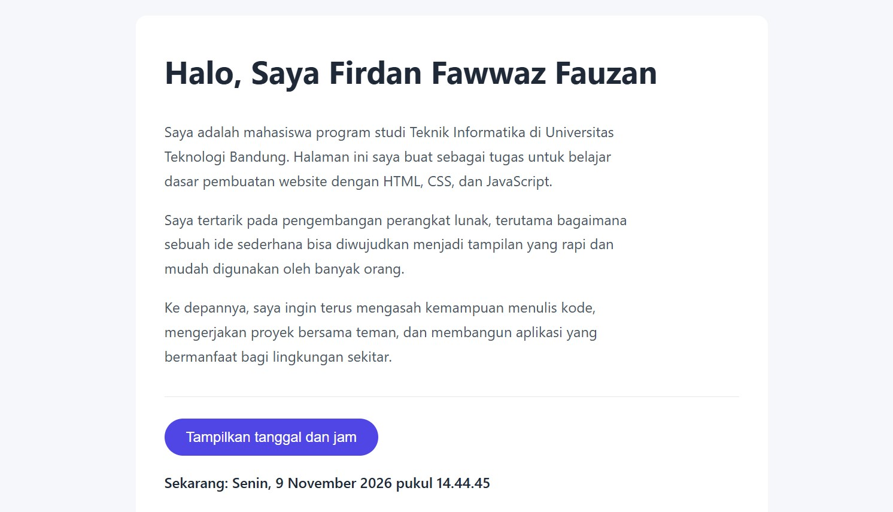

# Website Satu Halaman

Tugas membuat website satu halaman menggunakan HTML, CSS, dan JavaScript.

**Nama:** Firdan Fawwaz Fauzan
**Program Studi:** Teknik Informatika

## Tampilan

## Fitur

- Judul halaman (`<title>`) berisi nama mahasiswa yaitu Firdan Fawwaz Fauzan
- 1 heading dan 3 paragraf
- Desain warna background dan tombol berwarna indigo
- Tombol interaktif yang menampilkan tanggal dan jam saat diklik

## Teknologi

- HTML untuk struktur
- CSS untuk tampilan
- JavaScript untuk interaksi

## Cara Menjalankan

Unduh file `index.html`, lalu buka dengan browser.
